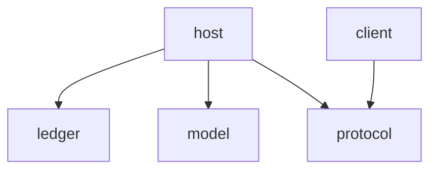

[GUIDE: Apply ASD-STE100 to source code, Mise-en-place to code design and thinking framework. Adapt Gall’s Law, Chesterton’s Fence, and Poka-yoke. Invoke Goodhart’s Law and Via Negativa when needed. Treat these principles as Wittgenstein’s Ladder. Build the real thing, not its imitation. Try to falsify it.] [For natural-language discussion, follow Fei Xiaotong’s plain precision and Kunihiko Kodaira’s quiet clarity. Avoid officialese, performative rhetoric, translationese, and textbook cadence. Let the subject shape the prose.]

万象基：以公理化方法重新设计的个人 AI 聊天客户端。万象只作参照，不作规格：不兼容其数据与协议，不照搬其功能清单，一切从下文公理重新演绎。

# AXIOM
1. [开发者] AXIOM 必须直接对应使用者或开发者真正在乎的事，并标注理由。
    - 理由：不写理由，规则就无从验证，也判断不了该删还是该留。
2. [开发者] LEMMA 必须是 AXIOM 或其他 LEMMA 的推论，并标注推理过程。
    - 理由：推理写明白，结论才能被复核、被推翻。
3. [开发者] SPEC 必须是 LEMMA，且能被生产或测试代码证明成立，并标注证明。
    - 理由：代码证明不了的规范落不了地。
4. [开发者] 所有代码和文档都是以上三者的衍生品，而且在满足它们的前提下最简实现。
    - 理由：需求要有出处，实现要能删、能改。
5. [使用者] 如果软件不能让用户满意，则需要进一步演绎出更多 LEMMA/SPEC。
    - 理由：用户满意与否是最终的验收标准。
6. [开发者] 如果演绎出更多 LEMMA/SPEC 的过程中发现无法判定句，考虑归纳分析出新的 AXIOM。
    - 理由：不补公理，演绎就卡在无法判定的地方。
7. [开发者] 在前六条可满足时，AXIOM、LEMMA、SPEC 三者的复杂程度越低越好，称之为奥卡姆剃刀。
    - 理由：体系越简单，越看得懂，越守得住。
8. [开发者] 行为先有一份最简且完整的契约实现，是为内核。内核单独成立。契约之外的行为只作可拆外层，外层不在时契约行为不变。
    - 理由：解耦靠删掉外层后内核仍能独立构建、独立证明，不靠多层的感觉。编译变慢、改一处牵一片，都是内核依赖了外层、或同一行为写了第二份。外层是装饰、包装还是调用处的函数，不改变这条判据。
9. [开发者] 实现只从本仓库的 AXIOM/LEMMA/SPEC 生长（clean-room）：万象的源码不作实现参照，不做对照移植。
    - 理由：参照旧实现会把它的设计缺陷带进新系统；重写要的是干净的设计。
10. [使用者] 对话是用户的资产：已确认的内容进程崩溃或断线后仍在；断电可以丢掉尚未落盘的尾部，恢复出来的历史必须自洽，不能出现半条、回卷或两种读法；中断不吃掉已生成的内容；全部历史可导出为通用格式。
    - 理由：聊天软件的全部价值沉淀在历史里。进程崩溃后已确认的还在，用户才敢信；整机断电时逼每一笔都先落盘，会拖垮生成。允许丢的只是尚未落盘的尾部，不是已经对用户确认过的内容。恢复结果若能读成两种样子，丢数据就变成了损坏。生成中断也不该吞掉已产生的价值。能带走，资产才真正属于用户。
11. [使用者] 数据与凭据在用户自己手里：不依赖第三方账号或云服务即可完整使用。
    - 理由：私人对话与模型密钥不该由别人托管。
12. [使用者] 未授权者进不来：网络入口默认拒绝匿名访问；已授予的访问权可吊销。
    - 理由：服务端存着全部私人历史与模型凭据，暴露一次就是全部暴露。
13. [使用者] 模型层由用户做主：服务商与模型自选；模型具备的能力（思维链、工具、多模态、用量）完整到达用户。
    - 理由：用户为模型的能力付钱，中间层削平一项就是用户的损失；服务商锁定则剥夺用户的选择。
14. [使用者] 对话实时可控：生成即时可见、可随时停止。
    - 理由：聊天的体验就是对话；不可控与卡顿直接毁掉体验。
15. [使用者] 失败可理解、可行动：错误说明发生了什么、在哪里、怎样重试或修复。
    - 理由：看不懂的异常等于没有提示；用户要的是下一步动作。
16. [使用者] 系统具有良好封装：用户无需理解什么叫丢弃、截断、降级或覆盖；只要用户能理解系统用法，不必强求用户的理解和真实发生的事件一致。
    - 理由：认知负担该落在系统身上。丢弃、截断、降级、覆盖是实现层的概念，用户只需学会用法；要求用户的理解与真实事件一致，就是让用户替系统背实现细节。
17. [使用者] 最大授权：程序视为持有用户的最高信任，执行用户与模型的操作不再额外请求授权；反过来程序完全信任用户，除防呆外不限制用户的操作。防呆只针对不可撤销的操作：永久删除对话、清除本机数据，两者各确认一次。
    - 理由：这是用户自己的机器、自己的密钥、自己的对话。每多一道审批或限制，都是让用户替程序再确认一次自己已经决定的事，打断对话，也增加用户要理解的东西。该防的只有手滑，手滑只在不可撤销时才挽回不了。AXIOM 12 管谁算用户，网络入口仍拒绝匿名、凭据仍可吊销；本条只作用于已通过 AXIOM 12 的用户和程序自身。

# LEMMA
1. [AXIOM: 1, 2, 3, 6, 7] 体系可以整体变换：重组条目、合并同义条目、把条目移到它真正所属的层（SPEC 改为 LEMMA、上溯为 AXIOM）或所属的包，目的是更简单。接手项目时，从实现细节反推原始需求，称之为第一性原理。
    - 推理：AXIOM 1–3 给出各层判定标准，旧条目据此可以重判；AXIOM 6 遇到无法判定句时本就要求上溯；AXIOM 7 要求复杂程度最低，变换正是手段。
2. [AXIOM: 4, 8] 同一事实只留一个手写出处。缓存、生成物、文档副本必须机械再生，禁止手改。
    - 推理：AXIOM 4 要求最简实现，第二份手写副本不提供新功能；AXIOM 8 要求内核单独成立，两份手写副本必须一起改，删掉任一份内核就不再完整。手写一份，其余交给工具再生。
3. [AXIOM: 4, 5, 7, 8; LEMMA: 2] 删不掉的东西集中登记在一处（见下文“例外登记”）：兼容层、开关、废弃接口、内核对外层的依赖、违反分包判据的包。每项写清使用方与解除条件，条件满足即删。写不出使用方与解除条件的，不建；已建的现在就删。
    - 推理：AXIOM 4 要求能删先删；AXIOM 5 要求删不掉的说明它承载着用户在乎的事，必须形式化，登记处就是落点。LEMMA 2 要求同一事实只有一处手写，例外清单就是那一处。AXIOM 8 禁止内核依赖外层，做不到的依赖不能散落在注释里。
4. [AXIOM: 4, 7, 8; LEMMA: 2] 同一执行进度只留一个权威表示。单次调用内的顺序过程交给语言的执行机制；只有跨调用保留、并发协调、外部观察或持久恢复所需的状态才显式建模。
    - 推理：AXIOM 4、7 要求最简实现。语言已经管理的执行位置，再用可变字段表示一次，不提供新的契约行为，却多出一处要维护的事实，违反 LEMMA 2。AXIOM 8 要求内核行为完整，所以确实承担契约约束的状态（流解析的跨块状态、停止与完成的竞争、凭据的有效与吊销、持久化与恢复）不能为了消除状态机而删掉。判据只有一句：这个状态是否表达了调用栈独自承担不了的事实？不能，就删。
5. [AXIOM: 4, 8, 10; LEMMA: 2] 可变状态由明确的内核对象或模块持有。跨边界只开放受控操作，或开放不能反向修改内部状态的结果。内部是否原地修改，以满足契约的最简实现为准。
    - 推理：AXIOM 10 要求历史只有一个自洽的权威结果；多个边界能绕过同一所有者修改状态，就无法只凭该所有者的契约保证结果。AXIOM 8 要求内核单独成立，外层不能直接维护内核的内部状态。AXIOM 4 与 LEMMA 2 排除多份独立的状态权威。对象、闭包、模块私有变量、不可变快照都可以做所有者；这条保护的是封装，不是某种范式的名字。
6. [AXIOM: 4, 5, 7, 8] 契约之外的行为只经可拆外层组合进来。组合方式以依赖最少、删除最容易、契约不变为准，不预设继承、对象包装或高阶函数的优劣。
    - 推理：AXIOM 8 要求内核单独成立；AXIOM 4、7 要求最简，外层不能迫使内核增加与契约无关的结构；外层若删不掉，按 AXIOM 5 就得说明它承载了什么。高阶函数同样可以持有状态、吞掉异常、重复发送请求，所以它是否合格要看删除检验，不看形式。
7. [AXIOM: 6, 10, 14, 16] “已确认”以 LLM 请求发出为界：一次请求发出时，它携带的全部内容即为已确认；实时流式显示的文字不算已确认，直到它作为上下文随下一次请求发出。
    - 推理：AXIOM 10 与 AXIOM 14 的对象不天然相同，按 AXIOM 6 须补一条判定句。以请求发出为界，确认点是系统自己触发的离散事件，可测、可持久化；流式文字逐块落盘会拖垮生成，AXIOM 10 允许断电丢掉的尾部正是这部分。用户只看到连续的对话，按 AXIOM 16 无需理解这一区分。
8. [AXIOM: 7, 8; LEMMA: 3, 5] 包为 `ledger`、`model`、`protocol`、`host`、`client` 五个（见下文“分包”）。一块行为单独成包，当且仅当它独占某类可变状态并且契约能单独证明；内核契约相同的合为一包。`protocol` 是登记的例外。
    - 推理：LEMMA 5 要求每类可变状态有唯一所有者，包是所有者的最大单位；AXIOM 8 要求内核单独证明，包是证明的单位。两条都满足才值得多一条依赖边，否则按 AXIOM 7 合并。不满足判据又必须独立的，按 LEMMA 3 登记。

# SPEC
1. [AXIOM: 4, 7, 8; LEMMA: 3, 6, 8] 每个子文件夹是可正交编译的子模块，成立与否用三项检查判定：子模块能单独构建并跑自己的测试；子模块依赖图无环；依赖图与 LEMMA 8 的分包一致。做不到正交的耦合对集中登记（见 LEMMA 3）：谁依赖谁、为何。本文的结构即为落盘样例：命名就是 AGENTS.md，分布在各子文件夹，但 GUIDE 只有项目根目录一份。
    内核不引入外层模块也能单独构建并跑契约测试；加入或移除契约之外的外层，相同输入下契约可观察的结果（用户输出、错误语义、数据变化）一致。
    - 证明：子模块落盘后，逐个单独构建、跑测试、跑依赖图检查；内核分别以有外层、无外层两种装配跑同一组契约测试并比对结果。当前各包尚无代码，构建与测试检查空真；文件分布与依赖图随时可直接查对。
2. [LEMMA: 5] 内核的可变状态不能经公共返回值或跨模块引用绕过所有者修改。
    - 证明：构造持有可变内部状态的内核实例，经公共接口取得对外结果；修改该结果，再读内核状态，验证未被改动。再结合目标语言的可见性、所有权或静态类型检查，排除受限的引用逃逸。字段私有不等于无逃逸：原样返回内部数组的 getter 照样泄漏写权限。测试只证明覆盖到的操作，不凭几个样例声称排除了全部逃逸路径。

# 分包
依 LEMMA 8。各包的 AXIOM/LEMMA/SPEC 写在 `<包>/AGENTS.md`，引用本文条目时写作“根 AXIOM n”“根 LEMMA n”。未判定的问题集中在 [OPEN.md](OPEN.md)。

| 包 | 独占的状态 | 能单独证明的契约 | 可拆外层 | 服务的 AXIOM |
|---|---|---|---|---|
| [`ledger`](ledger/AGENTS.md) 对话账本 | 已确认历史、附件 | 批次原子、不改写、恢复自洽、导出完整 | 附件回收、搜索（若保留） | 10、11、16 |
| [`model`](model/AGENTS.md) 外部调用 | 单次调用内的流解析状态；工具连接 | 一次调用：能力先声明、至多一次、可停止 | 各服务商传输、工具适配 | 13、14、15 |
| [`protocol`](protocol/AGENTS.md) 线上契约 | 无 | 消息的唯一定义与编解码 | 无 | 15 |
| [`host`](host/AGENTS.md) 主机 | 进行中的生成、凭据、配置 | 确认边界与停止竞争；吊销；配置 | 自动标题、诊断 | 10、11、12、14、15、17 |
| [`client`](client/AGENTS.md) 客户端 | 视图状态、输入框内容 | 两副外壳一致；防呆 | 桌面外壳、浏览器外壳、渲染、主题、快捷键 | 14、16、17 |

`ledger`、`model`、`protocol` 互不依赖。`client` 不依赖 `host`，两者只经 `protocol` 和网络相连，本机也一样。确认边界（LEMMA 7）在 `host`：先落账，后发出。

# 例外登记
依 LEMMA 3。每项写明使用方与解除条件。

| 例外 | 使用方 | 解除条件 |
|---|---|---|
| `protocol` 无状态仍单独成包，违反 LEMMA 8 的判据 | `host`、`client` | 主机与客户端合为一个进程 |
